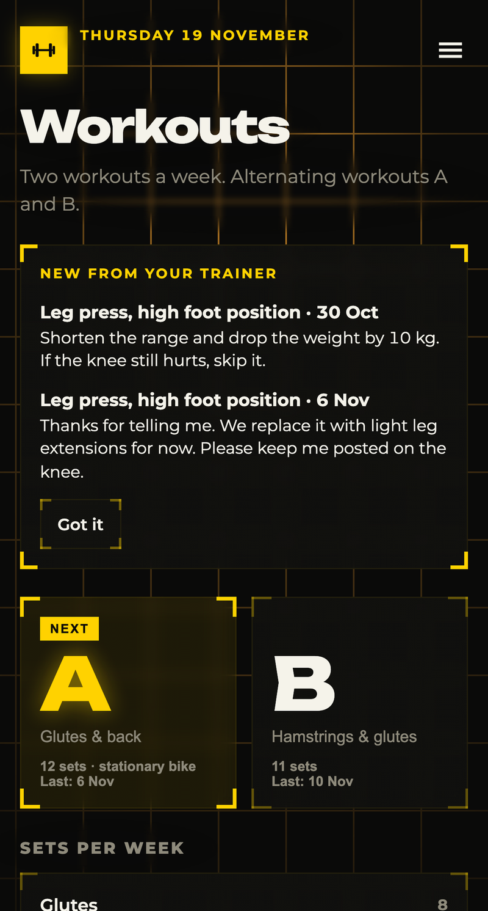
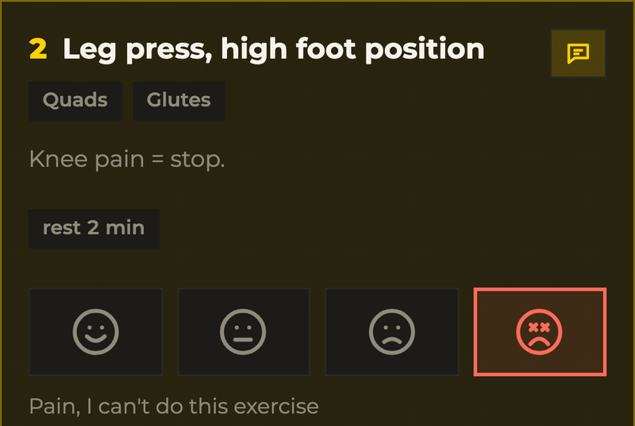
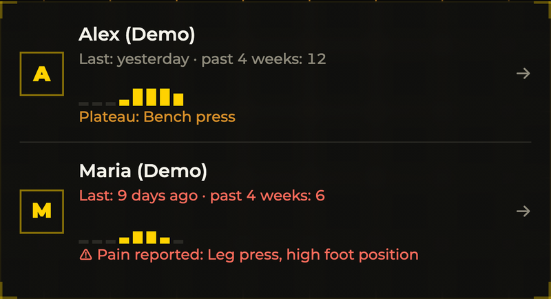
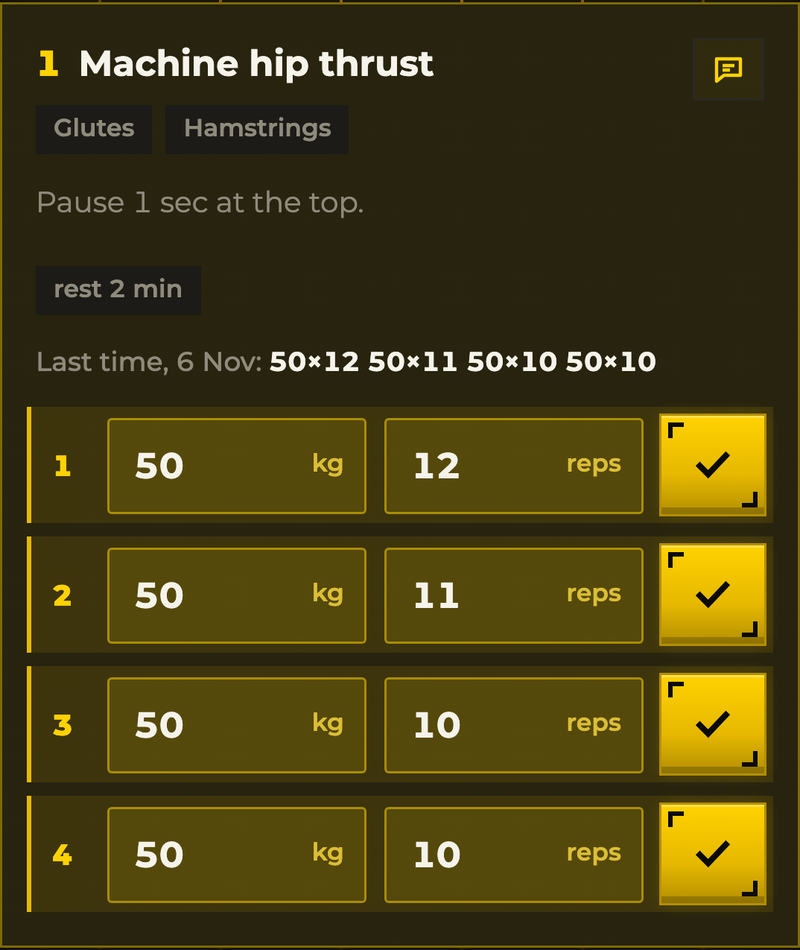
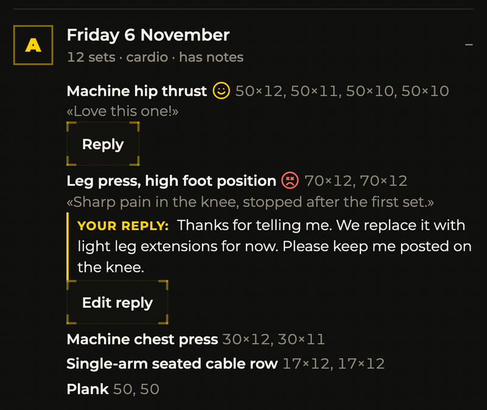
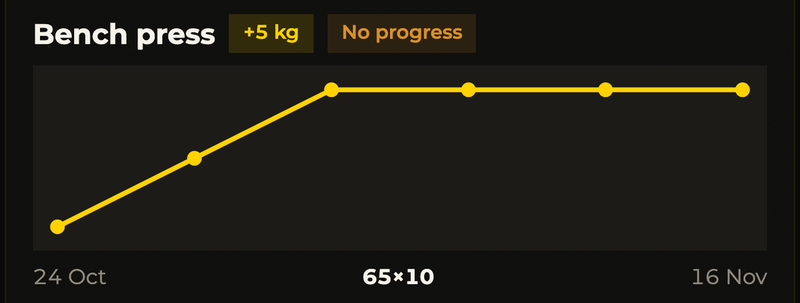
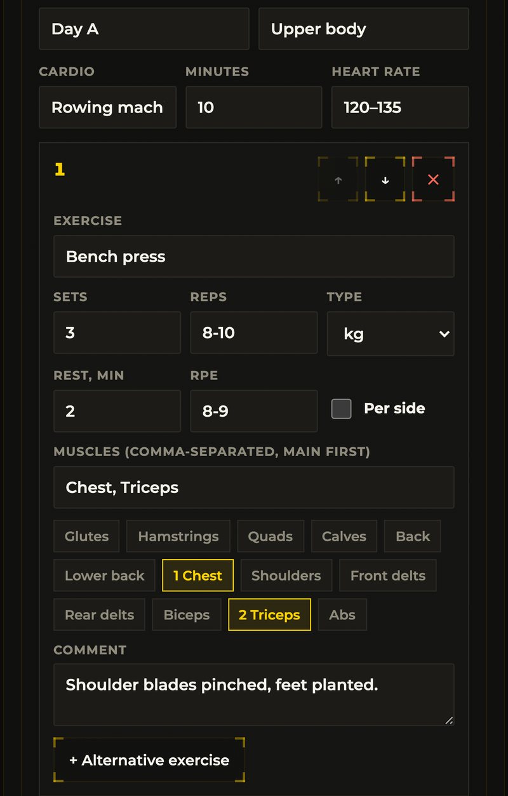

# Workouts

A simple workout log I built for coaching my friends: a phone app for them, a panel for me.

<p>
  
  
  
</p>

## Try the demo

Both links show only fictional clients (Alex and Maria), not real people.

- **Client app (Maria):** https://antonytroject.github.io/tony-workouts/?c=abwaxnh6
- **Coach panel:** https://antonytroject.github.io/tony-workouts/?admin=r9bwnx8dxkvv4v446u5hdxvw

Open the client link on a phone and add it to the home screen to use it like an app.

## What it really is

A nicer interface for a Google Sheet. Nothing here is new: all of it could live in a spreadsheet, and at first it did. But typing sets into a sheet at the gym is slow, and reading one as a coach is hard. So I built two screens on top of it: one for logging, one for reviewing.

The app saves the coach time. It does not plan training: every decision stays with the coach.

## One loop, end to end

| 1. The client logs a workout | 2. The coach sees it | 3. The coach replies |
|---|---|---|
|  |  |  |
| Weight and reps per set, last time shown, one tap on how the exercise felt, a short note. | Clients who stopped training, reported pain or hit a plateau stand out in the list. | The reply shows up in the client's app the next time they open it. |

## Client app

- Workout days (A, B, …) with the next one highlighted.
- Weight and reps per set, with last time's numbers as hints. RPE, rest time, exercise swaps.
- How did it feel? Four faces per exercise: feels great · no pain but I don't like it · mild muscle pain · pain, I can't do it.
- Notes per exercise and per workout, and the coach's replies to them.
- Weekly sets per muscle group.
- Works offline: the workout stays on the phone and is sent when the connection is back.
- English and Russian, eight color themes, installs to the home screen.

## Coach panel

- All clients at a glance: last workout, eight weeks of activity, streaks.
- Flags: long break, pain reported, plateau (the last three sessions are no better than the one before).
- Progress chart for every exercise.
- Workout log with replies to notes.
- Program editor: exercises, sets, reps, type (kg, bodyweight, seconds), rest, RPE, per side, muscles, comment, alternative exercise, order.
- Add clients, copy programs, set a client's language, keep a private note.
- Demo mode: a separate code that shows only fictional clients, so the panel can be shared safely.

<p>
  
  
</p>

## How it works

```
Client app / coach panel  ──►  Google Apps Script  ──►  Google Sheet
index.html on GitHub Pages     JSON API, checks codes    the database the coach can open
```

- **One HTML file**, plain JavaScript, no framework and no build step.
- **Backend:** Google Apps Script. Access is by secret codes: one per client, one for the coach, one for the demo.
- **Database:** a Google Sheet the coach can open and edit directly.
- **Free to run:** GitHub Pages, Apps Script and Google Sheets.
- **Offline first:** workouts are stored on the phone until they are sent.

This repository holds only the front end that GitHub Pages serves. The Apps Script code and all real data are kept private.

## How it was made

Built step by step with [Claude Code](https://claude.com/claude-code), from feedback of the few people who actually use it.
